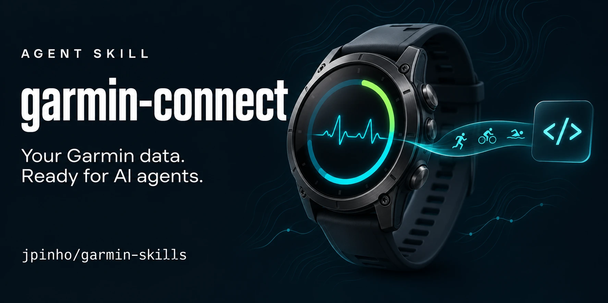

# garmin-skills



Agent skills for working with your own Garmin data.

## `garmin-connect`

Read-only access to your Garmin Connect data through Garmin's official [Personal API](https://developer.garmin.com/gc-developer-program/personal/personal-api/). It covers:
- activities and their detail records, and the original FIT files
- HRV and sleep
- daily wellness: resting HR, Body Battery, stress, calories
- weight and body composition
- the food log, HR zones and fitness age

It can also build a gzipped local archive of all of it, with GPS stripped.

```
.claude-plugin/             # marketplace.json + plugin.json (Claude Code plugin)
skills/garmin-connect/
├── SKILL.md                  # when and how the agent uses it
├── scripts/
│   ├── garmin_fetch.py       # auth, single GETs, full archive (stdlib only)
│   ├── garmin_fit.py         # metrics from a FIT file (needs fitdecode, numpy)
│   └── garmin_spec.py        # fetches Garmin's OpenAPI spec and looks up schemas
└── references/
    ├── endpoints.md          # all 26 endpoints, params, range limits, auth facts
    └── data-model.md         # archive files, units, key fields, joins
```

### Install

As a Claude Code plugin (Claude Code 2.1.275 or later):

```
/plugin install garmin-connect --marketplace jpinho/garmin-skills
```

On older versions, add the marketplace first, then install:

```
/plugin marketplace add jpinho/garmin-skills
/plugin install garmin-connect@garmin-skills
```

There's no pinned version, so `/plugin marketplace update garmin-skills` gets the latest commit. Or turn on auto-update under **Marketplaces** in `/plugin`.

Any other agent that reads `SKILL.md`: copy `skills/garmin-connect/` into its skills directory, e.g. `.claude/skills/` in a project.

### Setup

1. Create a personal API key in Garmin Connect: Settings → Personal API key.
2. Expose it as `GARMIN_API_KEY`. In Claude Code cloud, set it as an **environment variable**, not a Network secret: the proxy would otherwise overwrite the bearer token on every call.
3. Check it works. With the plugin installed, the scripts live under the plugin's cache directory, so it's easiest to ask the agent to "check my Garmin key". From a clone:

```bash
python3 skills/garmin-connect/scripts/garmin_fetch.py check
```

`check` prints the token scopes and expiry. It never prints the key or the token.

### Notes

- The API is read-only: there's no workout upload and no comments.
- Training status, readiness, VO2 max history and the race predictor aren't exposed.
- The rate limit is about 100 requests a minute, and the script backs off on HTTP 429.
- Garmin's API spec is their documentation. `garmin_spec.py` fetches it on demand instead of shipping a copy.

## License

[MIT](LICENSE). Garmin and Garmin Connect are trademarks of Garmin Ltd.; this project is not affiliated with or endorsed by Garmin.
